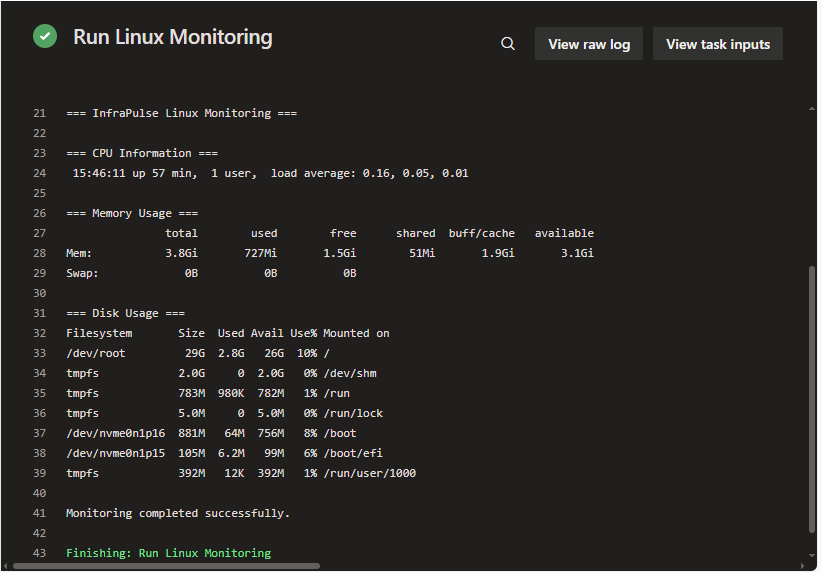

# InfraPulse Linux Monitoring CI/CD

## Project Overview

This project automates Linux system monitoring using Azure DevOps Pipelines and a self-hosted agent running on an Azure Linux Virtual Machine.

## Technologies Used

- Microsoft Azure Virtual Machine (Ubuntu Linux)
- Azure DevOps Pipelines (YAML)
- Self-hosted Linux Agent
- Bash
- Git and GitHub

## Architecture

GitHub Repository → Azure DevOps Pipeline → Self-hosted Agent on Azure Linux VM → Monitoring Output

## Pipeline Execution Output

## Monitoring Commands

| Command | Purpose |
|---|---|
| `uptime` | Displays system uptime and load average |
| `free -h` | Displays memory usage |
| `df -h` | Displays disk utilization |

## Pipeline Execution

The pipeline runs on the self-hosted Linux agent hosted on an Azure VM and displays system monitoring information in the Azure DevOps logs.

The pipeline checks:
- System load average
- Memory usage
- Disk space utilization

## Key Learnings

- Configuring a self-hosted Azure DevOps agent on an Azure Linux VM
- Running YAML-based CI/CD pipelines
- Executing Linux monitoring commands through automation
- Reviewing pipeline logs and execution status

## Author

**Sharanjeet Kaur**

GitHub: [@sharanjeetaulakh](https://github.com/sharanjeetaulakh)
